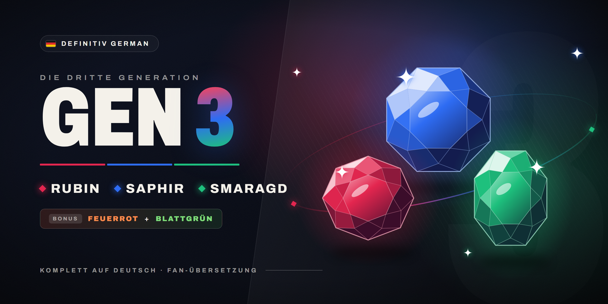

# Definitiv German Gen 3

Komplett deutsche Rubin-, Saphir-, Smaragd-, Feuerrote und Blattgrüne Edition für [gen1recomp](https://github.com/bryanthaboi/gen1recomp) – so, als wäre
die englische ROM die deutsche.

*A full German translation mod for gen1recomp (Ruby, Sapphire, Emerald, FireRed, LeafGreen). It reads everything from your own German ROMs.*

## Was der Mod macht

- **Alle Texte** – Dialoge, Kämpfe, Menüs, Pokédex-Einträge, Abspann – im Wortlaut der deutschen Originale
- **Alle Namen** – Pokémon, Attacken, Items, Trainer, Typen, Orte
- **Deutsche Schrift** – Umlaute, ß und die Sonderzeichen der deutschen Spiele
- **Deutsche Grafiken** – Titelbild, Statusseiten, Typ-Symbole, Pokédex, Trainerpass, PokéNav, Wettbewerb, PC-Boxen, Schilder an Pokémon-Center, Laden und Arena, Teachy-TV, Abspann
- **Deutsche Anordnung** – Menüs und Kästen sitzen wie im deutschen Original
- **Zusätze von gen1recomp** – Mod-Verwaltung, Optionen, Link- und Online-Bereich (Union-Kampf und -Tausch) auf
  Deutsch; der Launcher bleibt englisch

## Keine ROM-Inhalte enthalten

Der Mod enthält **keine Texte oder Grafiken der Spiele**. Er bringt nur Code und „Rezepte“ mit (Positionen in der
ROM). Beim Start liest er deine eigene deutsche ROM und baut daraus alles zusammen.

## Voraussetzungen

- gen1recomp (getestet mit **0.3.89**), mit importierter englischer ROM wie gewohnt
- Deine **deutsche ROM** der Edition, die du spielen willst (jede Edition braucht nur ihre eigene):

| Edition | MD5 |
|---|---|
| Smaragd-Edition | `f793a854654b467211fc32c4062cb183` |
| Rubin-Edition | `1af28ea547d4116dc752c93f7f694239` oder `9aa6ac6fd369a686373a2e1bf8bb6aa3` (beide Revisionen) |
| Saphir-Edition | `43906c58afaf0760f62ec698ef10eafc` oder `9d816b369343d39b94af9a8b0ce7f63b` (beide Revisionen) |
| Feuerrote Edition | `6648a0484a56097ca75d6af87ebce225` |
| Blattgrüne Edition | `4dd5e72f942a921d3fe53d21a39f4cba` |

## Installation

1. Im Launcher unter **MODS** den Mod suchen und installieren – oder die `.zip` aus dem
   [neuesten Release](https://github.com/FadeyMods/Definitiv-German-Gen-3/releases/latest) über
   **Import mod .zip** einspielen.
2. In den **Details** des Mods die deutsche(n) ROM(s) auswählen. Der Launcher prüft sie und legt sie beim Mod ab.
3. Mod aktivieren und spielen.

Falls noch der ältere Mod `deutsch-gen3` installiert ist: bitte entfernen – der Launcher meldet sonst einen
Konflikt.

Was sich in einer Version geändert hat, steht im jeweiligen
[Release](https://github.com/FadeyMods/Definitiv-German-Gen-3/releases).

Weitere Generationen: [Definitiv German Gen 1](https://github.com/FadeyMods/Definitiv-German-Gen-1) · [Definitiv German Gen 2](https://github.com/FadeyMods/Definitiv-German-Gen-2)
